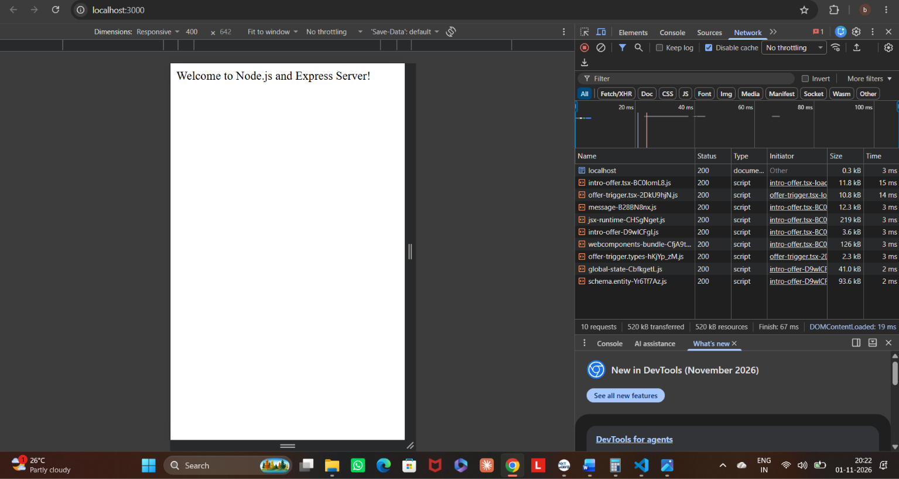
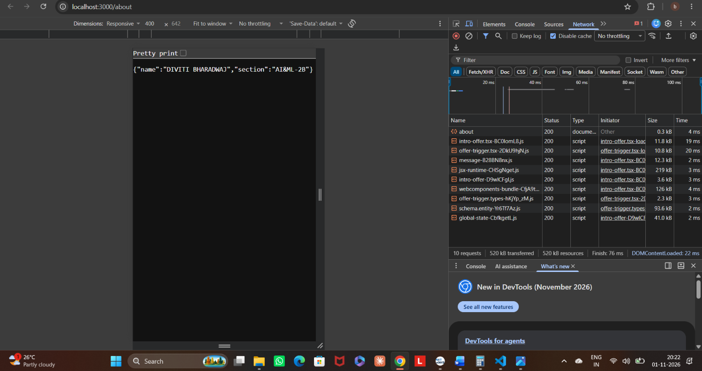
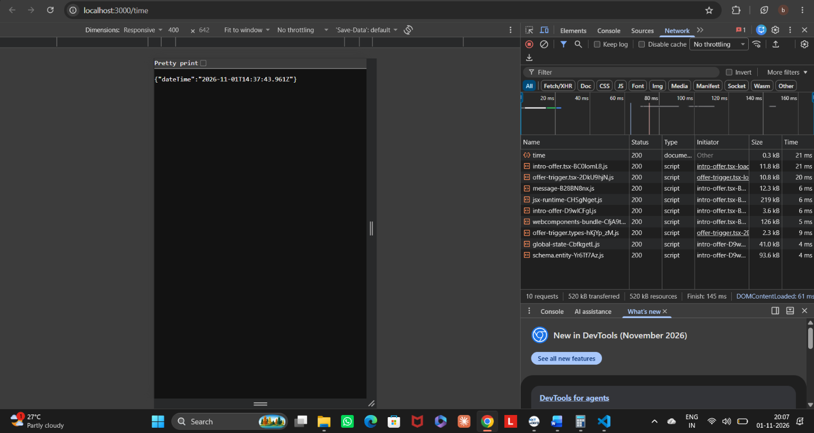
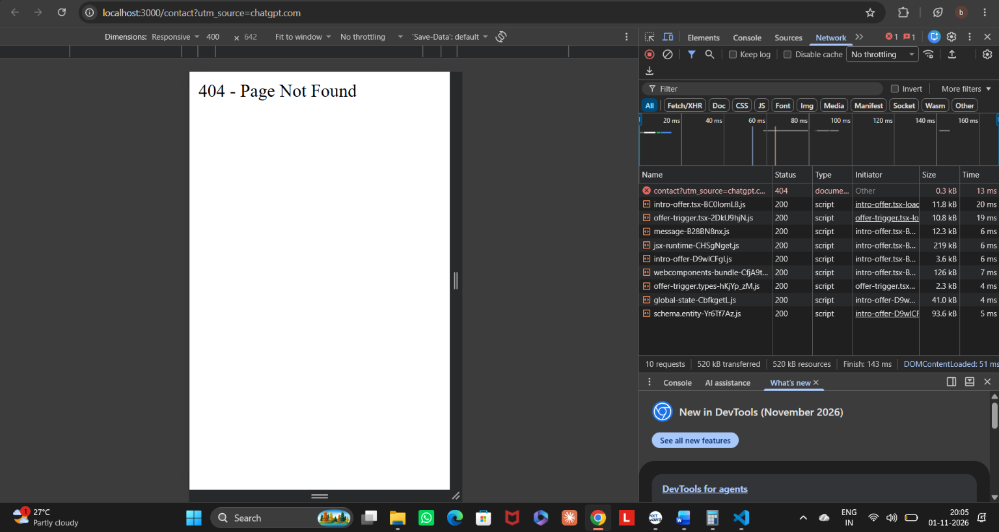

# Lab 1: Node.js and Express server

**Name:** DIVITI BHARADWAJ  
**Registration Number:** 252U1R6060
**Section:** AI&ML-2B

## Live Link
Not deployed yet. Deployment will be completed before final submission.

## Objective
To set up a Node.js project and build a small web server using the built-in HTTP module and Express.js.

## Technologies Used
- Node.js
- Express.js
- JavaScript
- Visual Studio Code

## Project Structure

```text
lab-01/
├── screenshots/
│   ├── home.png
│   ├── about.png
│   ├── time.png
│   └── 404.png
├── server.js
├── express-server.js
├── package.json
├── package-lock.json
├── .gitignore
└── README.md
```

## Installation and Execution

### 1. Clone the repository

```bash
git clone <your-github-repository-url>
```

### 2. Navigate to the project folder

```bash
cd lab-01
```

### 3. Install dependencies

```bash
npm install
```

### 4. Run the basic Node.js HTTP server

```bash
node server.js
```

Open `http://localhost:3000`.

### 5. Run the Express server

Stop the previous server using `Ctrl + C`.

```bash
node express-server.js
```

Open `http://localhost:3000`.

## API Endpoints

| Method | Endpoint | Description |
|---|---|---|
| GET | `/` | Displays the welcome message |
| GET | `/about` | Returns name and section in JSON format |
| GET | `/time` | Returns the current date and time |
| GET | `/contact` | Returns a 404 error for an unknown route |

## Screenshots

### 1. Home Route



### 2. About Route



### 3. Time Route



### 4. 404 Error Handling



## Concepts Learned

- Creating a Node.js project using npm.
- Understanding package.json and node_modules.
- Installing and using Express.js.
- Creating an HTTP server using `http.createServer()`.
- Creating GET routes using Express.
- Sending text and JSON responses.
- Generating current date and time using `new Date()`.
- Handling unknown routes using HTTP status code 404.

## Problems Faced and Solutions

1. Initially, commands intended for the ChatGPT interface were accidentally entered in the terminal. This was resolved by cancelling the terminal input.
2. Learned how to install Express and manage project dependencies.
3. Successfully created and tested the Node.js HTTP server and Express server.

## Conclusion

Successfully created a Node.js HTTP server and an Express.js server. Implemented three GET endpoints, tested their responses, and learned how to handle unknown routes using a 404 status code.